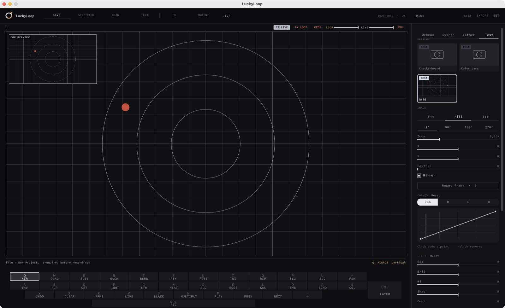
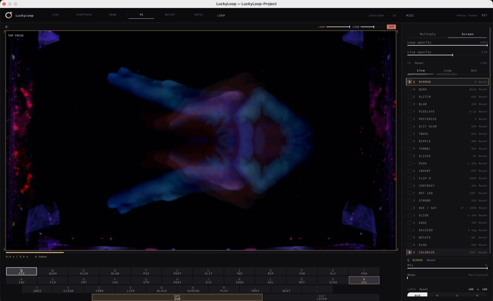
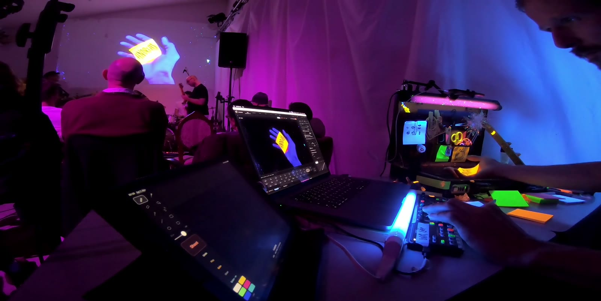
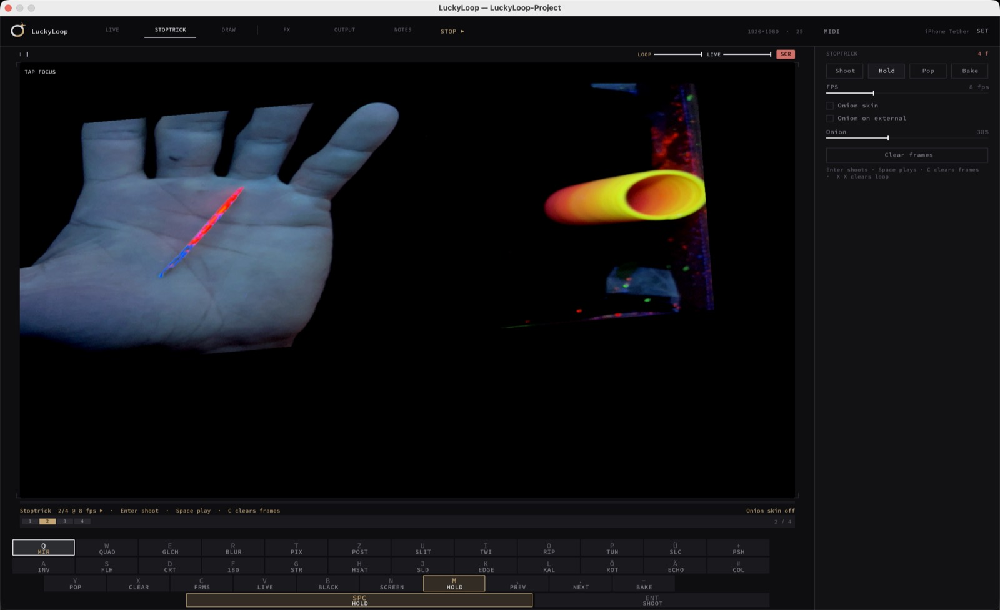
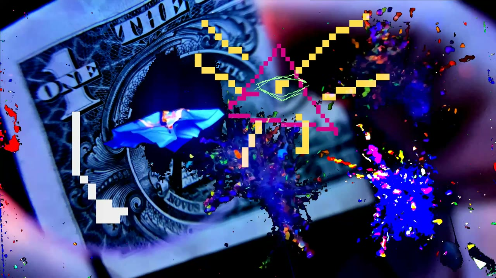
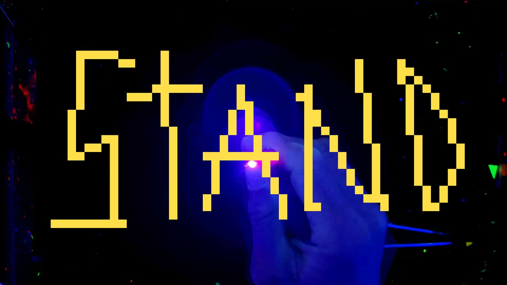
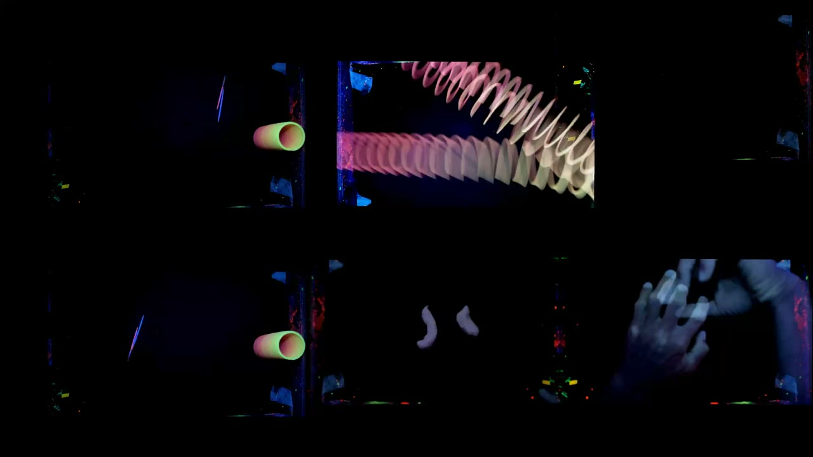
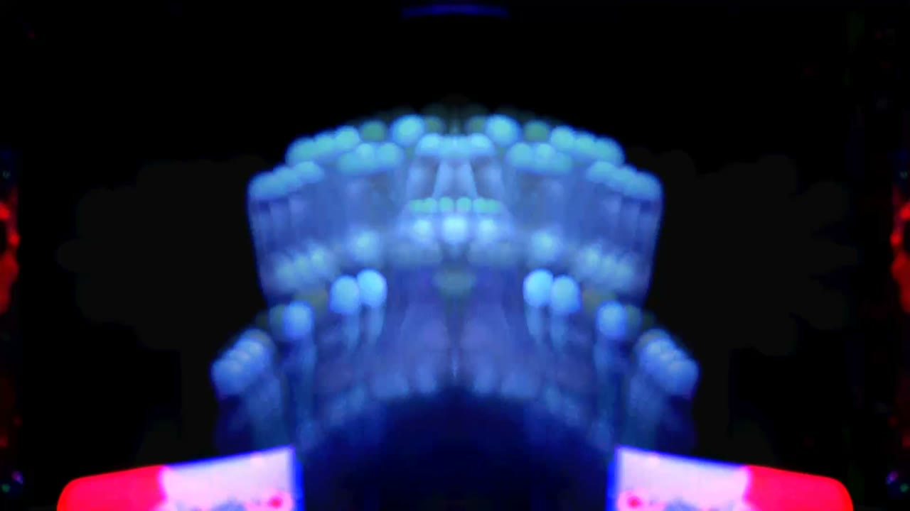
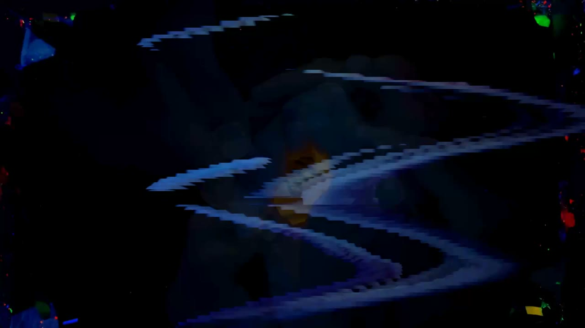
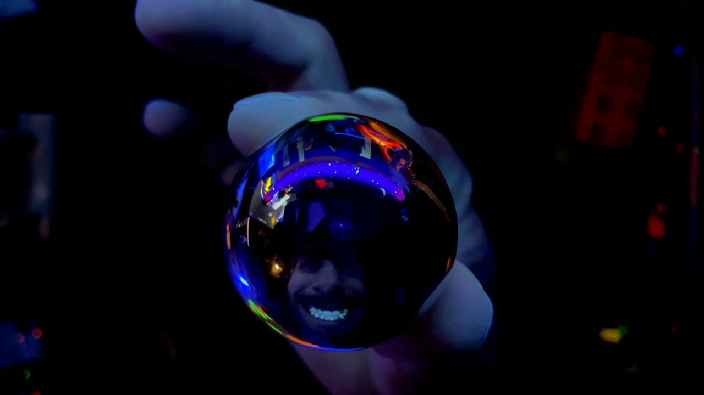

# LuckyLoop

LuckyLoop ist ein Live-Video-Instrument für macOS. Eine Kamera, ein iPhone oder ein Syphon-Bild wird zur Schleife, das Livebild liegt darüber, und jede weitere Aufnahme wird eine neue Ebene. Darüber liegen Stoptrick, Zeichnung, Text und Effekte. Das Ergebnis geht an Syphon und an einen zweiten Bildschirm.

Gebaut für improvisierte Bühnenbilder. Unten steht der Ablauf vom Auftritt **Styronauten, DH5**: Schwarzlicht, Gegenstände auf dem Tisch, Loops direkt zur Musik.

So sieht der leere Workspace aus, noch ohne Projekt. Quelle ist das Testbild Grid.



Im Set, Modus FX, Mirror auf dem Loop. Dieselben Leisten, dieselbe Tastatur, das Bild kommt von der Bühne.



## Ablauf einer Schleife

Die Leertaste startet die Aufnahme. Der nächste Druck speichert sie als Hap-Loop und spielt sie. Das Livebild bleibt darüber, gemischt mit **Multiply**, **Screen** oder **Normal**. Die nächste Aufnahme legt sich als weitere Ebene darüber. Die erste Aufnahme setzt die Länge, Undo holt die vorige Ebene zurück, ein Doppel-`X` löscht den Loop.

Quellen sind die Mac-Kamera, Continuity Camera, ein Testbild, Syphon oder das iPhone über LuckyTether. Gezeichnet wird am iPad mit LuckyPad.

## LuckyTether und LuckyPad

Zwei eigene Programme, nicht in diesem Repo. Sie liegen neben dem Sketch und verbinden sich über USB oder dasselbe Netz. LuckyLoop sucht sie von selbst.

Beim Styronauten-Abend, aus der GoPro: das iPad im Vordergrund ist LuckyPad, der Laptop zeigt LuckyLoop, an der Wand liegt dasselbe Bild. Die Kamera schaut auf den Lichttisch.



### LuckyTether

iPhone-App. Sie ist eine Bildquelle, kein Zeichenprogramm. Die Kamera wird als H.264 geschickt, Port 7878. Im Sketch die Quelle **Tether** wählen. Fokus, Belichtung und die Sperre stellt LuckyLoop, das Telefon führt sie aus. Der laufende Loop und das Onion-Bild können auf dem Display liegen, damit man beim nächsten Einzelbild sieht, was schon im Stapel ist.

### LuckyPad

iPad-App. Zeichenfläche für den Modus Draw, Port 7879. Dieselben Werkzeuge und dieselben sechs Farbfelder wie am Mac. Solange Draw an ist, geht der Strich in den Sketch und die Vorschau vom Mac kommt zurück aufs Pad. Ist Draw aus, bleibt die Verbindung, der Stift wartet. Onion, Play und die Zahl der Stoptrick-Bilder liest das Pad mit.

## Die sechs Modi

Die Leiste oben schaltet mit den Tasten `1` bis `6`. Live, Stoptrick und Draw sind Arbeitsmodi und schließen sich aus. Text, FX und Output legen sich darüber.

### 1 · Live

Das Bild der Quelle, zugeschnitten, gezoomt, gespiegelt und gegraded. Die Leertaste nimmt auf und overdubbt. `[` und `]` ändern die Deckkraft des Livebilds über dem Loop. Ein Einfachdruck auf `0` setzt den Bildausschnitt auf 100 Prozent. Ein zweiter Druck kurz danach schaltet alle FX aus und löscht die Textfelder.

### 2 · Stoptrick

Einzelbilder vom Livebild, als eigener kleiner Film über dem Hap-Loop.

Enter schießt ein Standbild auf den Stapel, bis zu 240 Bilder. Die Leertaste oder `M` spielt den Stapel mit eigener Bildrate, Voreinstellung 6 Bilder pro Sekunde. `,` und `.` gehen ein Bild vor oder zurück. Onion Skin liegt beim Schießen über dem Livebild. Der Stapel hat eigenen Zoom, Pan und Drehung.

`-` backt den Stapel auf den Hap-Loop. Die erste Ebene darf frei lang sein, jede weitere Bake ist ein Loop in der festgelegten Länge. Nach dem Bake können die Einzelbilder weg (Voreinstellung) oder liegen bleiben. `C` löscht nur den Stapel, der Hap-Loop bleibt.

Im Styronauten-Set ist das der Modus für einen Stab, einen Ball oder einen Kreisel. Hier zwei Bilder eines Stapels: der Stab auf der Hand, daneben das Rohr. Unten die Filmstreifen-Leiste, rechts Shoot, Hold, Pop und Bake.



### 3 · Draw

Farbe direkt auf dem Bild, im Stil von Paint. Werkzeuge: Stift, Pinsel, Radierer, Füllen, Pipette, Spray, Linie, Rechteck, Ellipse, abgerundetes Rechteck. Raster schaltet auf harte Pixel. Sechs Farbfelder, per Doppelklick ein HSL-Pad. `⌘` und Pinch ändern die Pinselgröße.

Gezeichnet wird mit der Maus, absolut mit dem Trackpad, oder vom iPad über LuckyPad. Die Tinte kann als Stoptrick-Bild mitgeschossen und mit `-` in den Hap-Loop gebacken werden. `Y` macht die letzte Geste rückgängig.





### 4 · Text

Textfelder auf dem Livebild. Pinch skaliert, Drehen rotiert, Ziehen verschiebt. Dieselben Felder liegen auf Syphon und auf dem Beamer, solange sie on air sind. In den Loop gebrannt werden sie nur, wenn Aufnahme für Text an ist. Solange ein Feld den Fokus hat, sind die Programm-Tasten stumm und es wird getippt. `´` zeigt die Felder auch außerhalb des Text-Modus in der Vorschau.

Im Set von DH5 lagen so Zeilen über einer bereits laufenden Collage, ohne den Loop neu aufzunehmen.

### 5 · FX

Effekte sitzen auf einem von drei Zielen: **Live**, **Loop** oder **Output**. Ein Tastendruck blendet den Effekt in 280 ms ein oder aus. Halten schiebt den Parameter.

| Gruppe | Effekte |
|---|---|
| Farbe | Hue / Sat, Saturation, Contrast, Posterize, Threshold, Invert, Solarize, Colorize |
| Form | Pixelate, Blur, Edge, Emboss, Glitch |
| Raum | Mirror, Mirror H, Mirror V, Quad, Kaleido, Twirl, Ripple, Bulge, Slices, Flip, Rotate, Rot 180 |
| Zeit | Echo, Trail, Strobe, SlitScan, RGB Delay |
| Bewegung | Slide, Push |

Deutsche Tastatur, obere Reihe `Q W E R T Z U I O P Ü +`:

Mirror, Quad, SlitScan, Glitch, Blur, Pixelate, Posterize, Twirl, Ripple, Bulge, Slices, Push.

Grundreihe `A S D F G H J K L Ö Ä #`:

Invert, Flip, Contrast, Rot 180, Strobe, Hue / Sat, Slide, Edge, Kaleido, Emboss, Echo, Colorize.

RGB Delay liegt in der Liste und bekommt eine Taste erst, wenn sie zugewiesen wird.







### 6 · Output

Zweiter Bildschirm, Vollbild, Ecken zum Ziehen für die Keystone-Korrektur. `R` setzt die Ecken zurück, `I` rückt sie etwas ein. Syphon-Ausgang ist unabhängig davon. `B` oder `9` blenden auf Schwarz. Ein kleines Live-Inset kann auf dem externen Bild liegen, ohne in den Loop zu gehen.



## Tasten

| Taste | Wirkung |
|---|---|
| `1` … `6` | Live, Stoptrick, Draw, Text, FX, Output |
| Leertaste | Live: aufnehmen oder Overdub. Stoptrick: Stapel abspielen |
| Enter | Stoptrick-Bild schießen |
| `-` | Stapel auf den Hap-Loop backen |
| `C` | Stoptrick-Bilder löschen, Loop bleibt |
| `X` `X` | Hap-Loop und alle Frame-Stapel löschen |
| `Y` | Undo. Im Draw die letzte Geste, im Stoptrick das letzte Bild, sonst die letzte Ebene. Mit Shift Redo |
| `N` | Multiply und Screen wechseln |
| `M` | Stoptrick-Play an oder aus |
| `,` `.` | Bild im Stapel, oder Ebene wählen |
| `B` | Blackout |
| `8` | Beamer an oder aus |
| `0` `0` | Ausschnitt zurück, FX aus, Text weg |
| `Q`…`#` | FX, siehe oben |

MIDI kann dieselben Funktionen belegen. Die Zuordnung liegt in der Set-Ansicht.

## Fallbeispiel Styronauten DH5

Das Projekt auf dem Rechner heißt `LuckyLoop-Project`. Es hat 668 Takes, `settings.json`, `text.json` und die Exporte unter `export/`. Die Bilder oben sind Einzelbilder aus diesen Loops, Stand 6. und 7. November 2026. Die Setliste behandelt jedes Stück als Rezept aus Modus, Gegenstand und Effekt, nicht als fertigen Clip.

| Stück | Was der Loop dabei tut |
|---|---|
| Zirkusfreak | Stoptrick eines Stabs, darüber mit Draw das Wort |
| Organic | Hand mit Mirror und Rotate, Hue-Ebene mit wenig Deckkraft, Echo, Ripple |
| Hoarder | Langsames Drop, dann Mirror, mit Undo zurück auf ein kleines Bild |
| Baheux | Kaleido. Bake ohne Löschen der Einzelbilder, danach verschieben |
| Disco Tuner | Stoptrick eines Balls, Draw setzt Rechtecke darüber |
| Polynaut | Post-its als Figuren, ein Bild pro Beat der Geschichte |
| Monolith | Unscharf als Erinnerung, Kreisel als feste Mitte, Text live darüber |

Dieselben Handgriffe — schießen, zeichnen, backen, Effekt auf Live oder Loop — laufen durch das ganze Set. Der Hap-Stapel bleibt das Gedächtnis, Stoptrick und Draw sind die Gesten darüber.

## Öffnen

1. [Processing](https://processing.org/) installieren.
2. Die Library **Syphon** über den Contribution Manager installieren. **Video** kommt mit Processing.
3. Diesen Ordner als Sketch öffnen (`LuckyLoop.pde`) und starten.

## Native Bibliotheken

Unter `data/` liegen die macOS-Bibliotheken, die der Sketch lädt. Neu bauen, wenn sie auf dem Rechner nicht laden:

```bash
bash native/build-macmenu.sh
bash native/build-midictl.sh
bash native/build-padctl.sh
bash native/build-tether.sh
bash native/build-h264dec.sh
```

Dafür braucht es die Xcode-Kommandozeilenwerkzeuge und ein JDK mit `jni.h`. Das JDK von Processing reicht. `JAVA_HOME` setzen, wenn ein Script `jni.h` nicht findet.

`libcamctl.dylib` steuert Belichtung, Fokus, Zoom und Continuity. Quelltext: `native/camctl.m` und `native/uvc.m`. Ein Build-Script dafür liegt nicht bei.

## Schriften

- Source Code Pro: SIL Open Font License, Text in `data/OFL.txt`
- Roboto Mono: Apache License 2.0

`data/settings.json`, `data/app.json` und `data/camera-diag.txt` sind der Stand von diesem Rechner, inklusive Projektpfaden.
