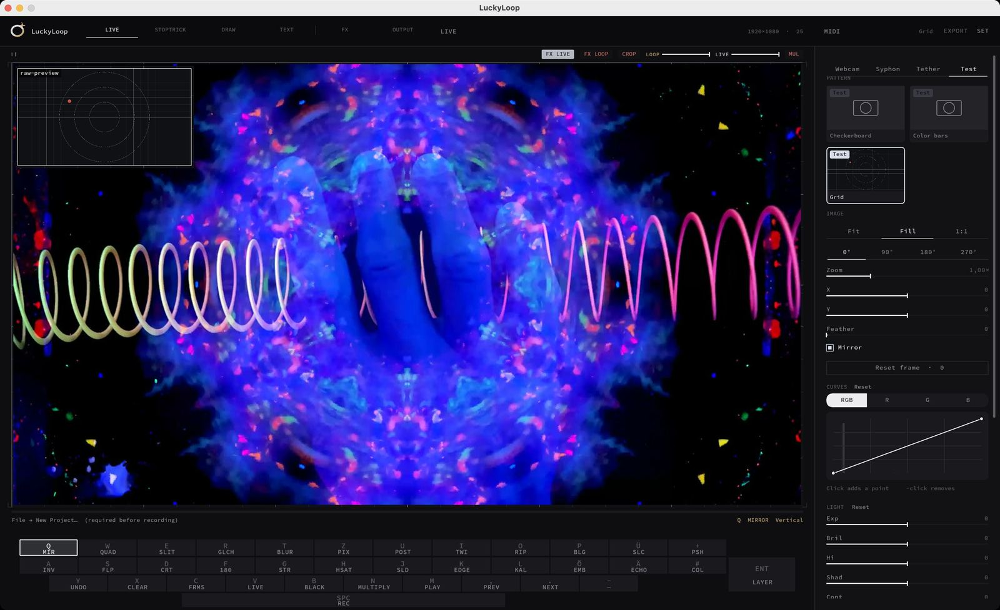
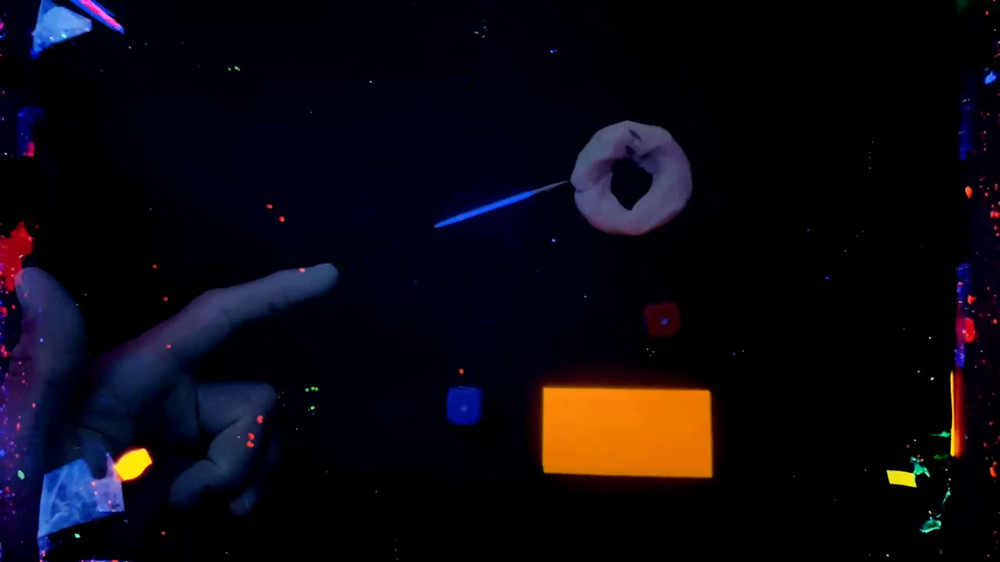
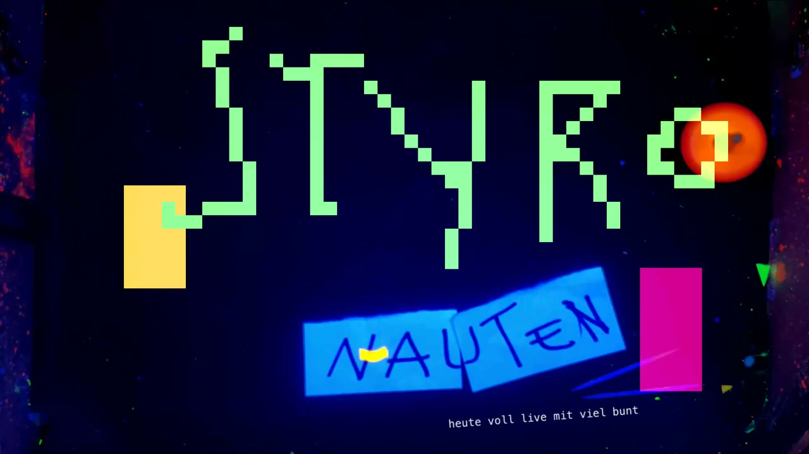
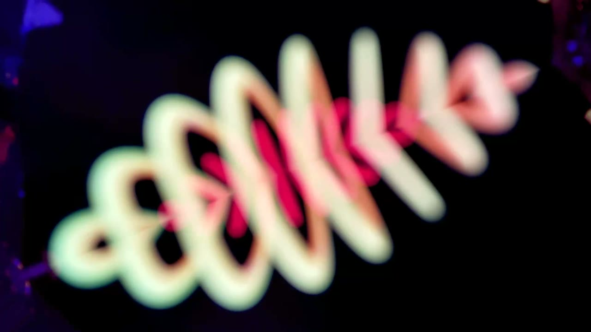
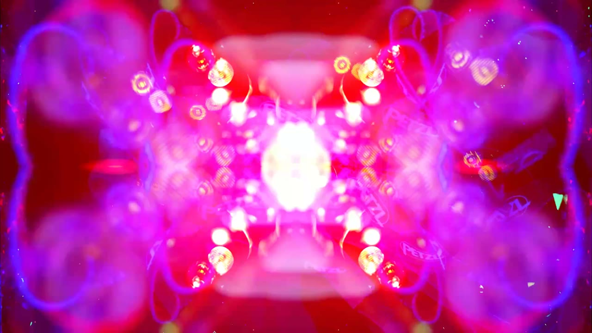
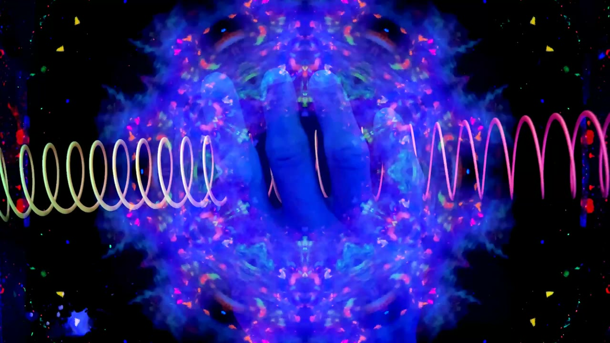
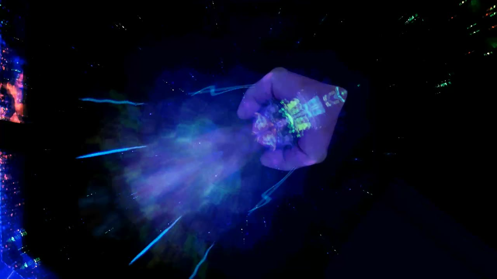

# LuckyLoop

LuckyLoop is a live video instrument for macOS. A camera, an iPhone, or a Syphon feed becomes a loop, the live image sits on top, and each further take becomes another layer. Stoptrick, drawing, text, and effects sit on top of that. The result goes out to Syphon and to a second display.

Built for improvised stage pictures. Below is the run of the show **Styronauten, DH5**: blacklight, objects on the table, loops played straight to the music.

The interface in FX mode. The six modes sit along the top, the effect list on the right, the keyboard along the bottom. The picture is an export from the Styronauten folder, a hand and a spring.



## How a loop runs

Space starts recording. The next press stores it as a Hap loop and plays it. The live image stays on top, blended with **Multiply**, **Screen**, or **Normal**. The next take stacks as another layer. The first take sets the length. Undo brings the previous layer back. A double `X` clears the loop.

Sources are the Mac camera, Continuity Camera, a test pattern, Syphon, or the iPhone through LuckyTether. Drawing is on the iPad with LuckyPad.

## LuckyTether and LuckyPad

Two separate programs, not in this repo. They sit next to the sketch and connect over USB or the same network. LuckyLoop finds them on its own.

At the Styronauten show, from the GoPro: the iPad in front is LuckyPad, the laptop shows LuckyLoop, and the same image is on the wall. The camera looks at the light table.


### LuckyTether

An iPhone app. It is a picture source, not a drawing program. The camera is sent as H.264 on port 7878. In the sketch, pick the source **Tether**. LuckyLoop sets focus, exposure, and the lock; the phone carries them out. The running loop and the onion image can sit on the phone display, so the next still shows what is already in the stack.

### LuckyPad

An iPad app. A drawing surface for Draw mode, on port 7879. The same tools and the same six swatches as on the Mac. While Draw is on, the stroke goes into the sketch and the preview comes back from the Mac to the pad. When Draw is off, the connection stays and the pen waits. The pad also reads onion, play, and the stoptrick frame count.

## The six modes

The bar at the top switches with keys `1` through `6`. Live, Stoptrick, and Draw are work modes and exclude each other. Text, FX, and Output sit on top of them.

### 1 · Live

The source image, cropped, zoomed, mirrored, and graded. Space records and overdubs. `[` and `]` change the opacity of the live image over the loop. A single press of `0` sets the framing back to 100 percent. A second press shortly after turns all FX off and clears the text fields.




### 2 · Stoptrick

Stills from the live image, a small film of their own on top of the Hap loop.

Enter shoots a still onto the stack, up to 240 frames. Space or `M` plays the stack at its own frame rate, 6 frames per second by default. `,` and `.` step one frame. Onion skin sits over the live image while shooting. The stack has its own zoom, pan, and rotation.

`-` bakes the stack onto the Hap loop. The first layer may be any length. Every later bake is a loop of the locked length. After the bake the stills can be cleared (the default) or kept. `C` clears only the stack. The Hap loop stays.

In the Styronauten set this is the mode for a stick, a ball, or a spinning top. Here are two frames of one stack: the stick on the hand, and the tube beside it. The filmstrip runs along the bottom. Shoot, Hold, Pop, and Bake are on the right.


### 3 · Draw

Paint straight onto the picture. Tools: pencil, brush, eraser, fill, eyedropper, spray, line, rectangle, ellipse, rounded rectangle. Raster switches to hard pixels. Six swatches; a double-click opens an HSL pad. `⌘` and pinch change the brush size.

Draw with the mouse, absolutely with the trackpad, or from the iPad through LuckyPad. Ink can be shot into the stoptrick stack and baked into the Hap loop with `-`. `Y` undoes the last gesture.


### 4 · Text

Text fields on the live image. Pinch scales, rotate turns, drag moves. The same fields go to Syphon and to the projector while they are on air. They are burned into the loop only when text recording is on. While a field has focus, program keys stay mute and typing goes into the field. `´` shows the fields in the preview even outside Text mode.

In the DH5 set, lines sat over a collage that was already running, without recording the loop again. Here the pixel type from Draw, the notes, and the small line underneath, all in one loop.



### 5 · FX

Effects sit on one of three targets: **Live**, **Loop**, or **Output**. A key tap fades the effect in or out over 280 ms. Holding the key nudges the parameter.

| Group | Effects |
|---|---|
| Color | Hue / Sat, Saturation, Contrast, Posterize, Threshold, Invert, Solarize, Colorize |
| Form | Pixelate, Blur, Edge, Emboss, Glitch |
| Space | Mirror, Mirror H, Mirror V, Quad, Kaleido, Twirl, Ripple, Bulge, Slices, Flip, Rotate, Rot 180 |
| Time | Echo, Trail, Strobe, SlitScan, RGB Delay |
| Motion | Slide, Push |

German keyboard, top row `Q W E R T Z U I O P Ü +`:

Mirror, Quad, SlitScan, Glitch, Blur, Pixelate, Posterize, Twirl, Ripple, Bulge, Slices, Push.

Home row `A S D F G H J K L Ö Ä #`:

Invert, Flip, Contrast, Rot 180, Strobe, Hue / Sat, Slide, Edge, Kaleido, Emboss, Echo, Colorize.

RGB Delay is in the list and gets a key only once one is assigned.


From the marked exports, the same stage:









### 6 · Output

A second display, fullscreen, with corners you can drag for keystone correction. `R` resets the corners, `I` insets them a little. The Syphon output is independent of that. `B` or `9` fades to black. A small live inset can sit on the external picture without going into the loop.

## Keys

| Key | What it does |
|---|---|
| `1` … `6` | Live, Stoptrick, Draw, Text, FX, Output |
| Space | Live: record or overdub. Stoptrick: play the stack |
| Enter | Shoot a stoptrick still |
| `-` | Bake the stack onto the Hap loop |
| `C` | Clear the stoptrick frames, keep the loop |
| `X` `X` | Clear the Hap loop and every frame stack |
| `Y` | Undo. In Draw, the last gesture. In Stoptrick, the last still. Otherwise the last layer. Shift for redo |
| `N` | Switch between Multiply and Screen |
| `M` | Stoptrick play on or off |
| `,` `.` | Step a frame in the stack, or pick a layer |
| `B` | Blackout |
| `8` | Projector on or off |
| `0` `0` | Framing back, FX off, text cleared |
| `Q`…`#` | FX, as listed above |

MIDI can map the same functions. The mapping lives in the Set view.

## Case study: Styronauten DH5

The project on this machine is called `LuckyLoop-Project`. It holds 668 takes, `settings.json`, `text.json`, and the exports under `export/`. The pictures above are frames from those loops, from 6 and 7 November 2026. The set list treats each piece as a recipe of mode, object, and effect, not as a finished clip.

| Piece | What the loop does |
|---|---|
| Zirkusfreak | Stoptrick of a stick, the word drawn over it |
| Organic | A hand with Mirror and Rotate, a Hue layer at low opacity, Echo, Ripple |
| Hoarder | A slow drop, then Mirror, then Undo back to a small picture |
| Baheux | Kaleido. Bake without clearing the stills, then move them |
| Disco Tuner | Stoptrick of a ball, with rectangles drawn over it |
| Polynaut | Post-its as figures, one picture per beat of the story |
| Monolith | Soft focus as a memory, a spinning top as a fixed center, text live on top |

The same moves — shoot, draw, bake, an effect on Live or Loop — run through the whole set. The Hap stack is the memory. Stoptrick and Draw are the gestures on top of it.

## Open

1. Install [Processing](https://processing.org/).
2. Install the **Syphon** library through the Contribution Manager. **Video** ships with Processing.
3. Open this folder as a sketch (`LuckyLoop.pde`) and run it.

## Native libraries

The macOS libraries the sketch loads live under `data/`. Rebuild them if they fail to load on this machine:

```bash
bash native/build-macmenu.sh
bash native/build-midictl.sh
bash native/build-padctl.sh
bash native/build-tether.sh
bash native/build-h264dec.sh
```

That needs the Xcode command-line tools and a JDK with `jni.h`. The JDK that ships with Processing is enough. Set `JAVA_HOME` if a script cannot find `jni.h`.

`libcamctl.dylib` controls exposure, focus, zoom, and Continuity. Source is `native/camctl.m` and `native/uvc.m`. There is no build script for it.

## Fonts

- Source Code Pro: SIL Open Font License, text in `data/OFL.txt`
- Roboto Mono: Apache License 2.0

`data/settings.json`, `data/app.json`, and `data/camera-diag.txt` are this machine's state, including project paths.
